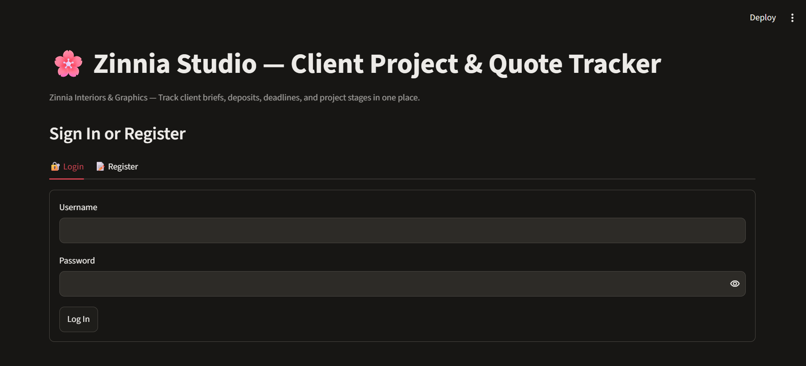
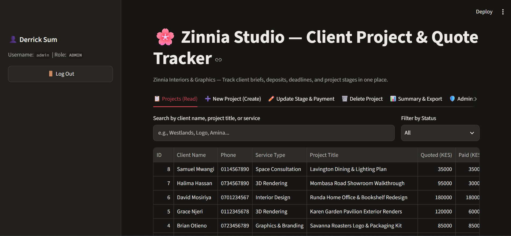
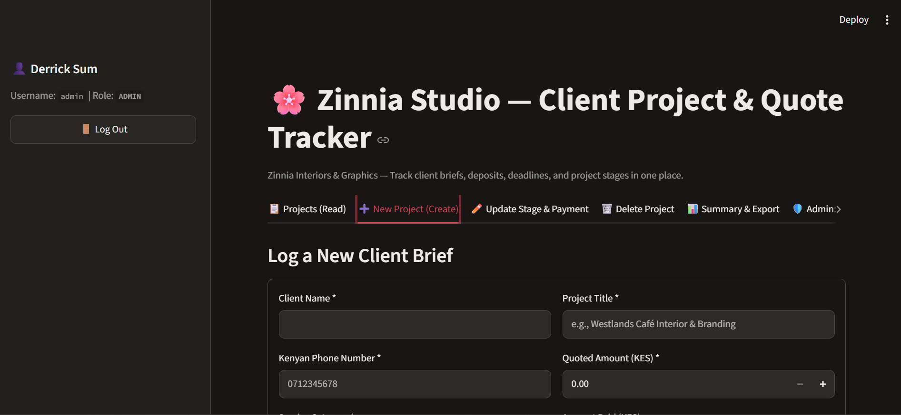
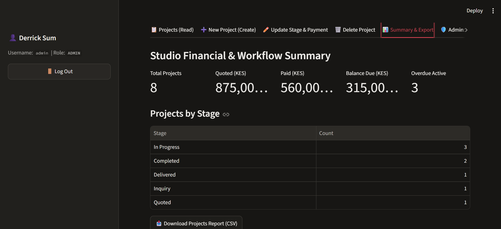

# 🌸 Zinnia Studio — Client Project & Quote Tracker

A full-stack web application built with **Python**, **Streamlit**, and **SQLite** for **Zinnia Interiors & Zinnia Graphics**. The system centralizes client briefs, quotes, deposit tracking, deadline monitoring, role-based team authentication, and CSV reporting in one lightweight dashboard.

## 📋 Table of Contents

 1. [Features Overview](#-features-overview)
 2. [Project Architecture & File Structure](#-project-architecture--file-structure)
 3. [Prerequisites](#-prerequisites)
 4. [Installation & Setup](#-installation--setup)
 5. [Environment Variables (`.env` & `.env.example`)](#-environment-variables-env--envexample)
 6. [Running the Application Locally](#-running-the-application-locally)
 7. [Screenshots & UI Walkthrough](#-screenshots--ui-walkthrough)
 8. [Validation & Business Rules](#-validation--business-rules)
 9. [Role-Based Access Control (RBAC)](#-role-based-access-control-rbac)
10. [Database Schema](#-database-schema)
11. [Git & Security Best Practices](#-git--security-best-practices)

## ✨ Features Overview

* **Authentication & Role-Based Security:**
  * Password hashing using **PBKDF2-HMAC-SHA256** with random 16-byte salts and constant-time digest verification (`secrets.compare_digest`).
  * Regex-enforced strong password policies during user registration.
  * Automatic initial administrator bootstrapping from `.env` variables (or Streamlit Secrets in production).
  * Distinct permission levels for **`admin`** and **`staff`** accounts.

* **Client Project Management (Full CRUD):**
  * **Create:** Log new client briefs with Kenyan phone validation, service categories, quoted amounts (KES), initial deposits, and target deadlines.
  * **Read & Filter:** Search projects dynamically by client name, project title, or service category, and filter by workflow stage.
  * **Update:** Transition project stages safely and record incremental client payments up to the quoted amount.
  * **Delete:** Admin-restricted deletion with explicit confirmation safeguards.

* **Automated Financial & Deadline Calculations:**
  * Real-time calculation of remaining balance due (`quoted_amount - amount_paid`).
  * Automatic overdue detection for active projects past their deadline (excluding `Completed` and `Delivered` projects).

* **Executive Summary & CSV Export:**
  * Live KPI cards showing total projects, total quoted revenue (KES), total collected payments (KES), outstanding balances (KES), and overdue project counts.
  * Stage breakdown table and one-click CSV report export (`zinnia_studio_projects.csv`).

## 🗂️ Project Architecture & File Structure

```text
zinnia-studio-tracker/
├── assets/              # Optional screenshots for documentation
│   ├── login_screen.png
│   ├── projects_dashboard.png
|   ├── create_update.png
│   └── summary_export.png
├── main.py              # Streamlit UI, session management, tabs, forms, and KPIs
├── database.py          # SQLite connection, schema creation, parameterized CRUD & user queries
├── project.py           # OOP ClientProject domain model, validation rules, and business methods
├── auth.py              # Password strength validation, PBKDF2 hashing, and verification
├── requirements.txt     # Python dependencies
├── .env                 # Local secrets & DB configuration (ignored by Git)
├── .env.example         # Safe template showing required environment variables
├── .gitignore           # Excludes .env, .venv, __pycache__, and *.db files
└── README.md            # Project documentation
```

## ⚙️ Prerequisites

* **Python 3.10+** (uses modern union type annotations such as `int | None` and `dict | None`)
* **pip** (Python package manager)
* **Git** (for version control)

## 🚀 Installation & Setup

1. **Clone the repository:**

   ```bash
   git clone https://github.com/Derroww/Zinnia_Studio_Capstone.git
   cd Zinnia_Studio_Capstone
   ```

2. **Create and activate a virtual environment:**

   * **Windows (Git Bash):**

     ```bash
     python -m venv .venv
     source .venv/Scripts/activate
     ```

   * **Windows (Command Prompt / PowerShell):**

     ```powershell
     python -m venv .venv
     .venv\Scripts\activate
     ```

   * **macOS / Linux:**

     ```bash
     python3 -m venv .venv
     source .venv/bin/activate
     ```

3. **Install dependencies:**

   ```bash

    pip install -r requirements.txt
   
   ```

   *(Contents of `requirements.txt`: `streamlit`, `python-dotenv`, `pandas`)*

4. **Configure environment variables:**
   Copy `.env.example` to `.env` and replace the placeholder credentials with your own values:

   ```bash
   cp .env.example .env
   ```

## 🔐 Environment Variables (`.env` & `.env.example`)

### `.env.example` Template (Safe to Commit)

```env
DB_NAME=zinnia_projects.db
ADMIN_USERNAME=admin
ADMIN_PASSWORD="ChangeMeToAStrongPassword123!"
ADMIN_FULL_NAME="Studio Admin"
```

### Variable Reference

| Variable | Required | Description |
| :--- | :--- | :--- |
| `DB_NAME` | Optional | SQLite database filename (defaults to `zinnia_projects.db`). |
| `ADMIN_USERNAME` | Yes | Username for the initial administrator account (stored in lowercase). |
| `ADMIN_PASSWORD` | Yes | Password for the initial administrator account. Wrap in quotes if using `#` or `$`. |
| `ADMIN_FULL_NAME` | Optional | Display name for the initial admin (defaults to `Studio Admin`). |

> **Note:** `database.ensure_initial_admin()` creates the initial admin account **only when no `admin` user exists** in the `users` table. Updating `ADMIN_PASSWORD` in `.env` later will not overwrite an existing admin record in SQLite.

## ▶️ Running the Application Locally

With your virtual environment activated, launch the Streamlit server:

```bash
streamlit run main.py
```

Streamlit will start a local web server and open the application in your default browser at `http://localhost:8501`.


## 📸 Screenshots & UI Walkthrough

Add screenshots of your running application to an `assets/` folder in the root directory to showcase each view in your repository:

1. **Authentication Screen (`assets/login_screen.png`):**
   * Split tabs for **Login** and **Register** with strong-password validation feedback.
2. **Projects Dashboard (`assets/projects_dashboard.png`):**
   * Live search bar, status filter dropdown, and full project table displaying calculated **Balance Due (KES)** and **Overdue** indicators.
3. **New Project & Stage Updates (`assets/create_update.png`):**
   * Form validation for Kenyan phone numbers (`07...` / `01...`), service categories, deposits, and workflow stage transitions.
4. **Summary & Export (`assets/summary_export.png`):**
   * Five executive KPI metric cards, stage breakdown table, and one-click CSV download button.

```markdown









```

## 📏 Validation & Business Rules

### 1. Client & Project Validation (`project.py`)

* **Client Name & Project Title:** Required non-empty strings.
* **Kenyan Phone Number:** Normalized by stripping spaces and hyphens, then validated against `^0[17]\d{8}$` (10 digits starting with `07` or `01`, e.g., `0712345678`).
* **Service Types:** Must be one of:
  * `Interior Design`
  * `Graphics & Branding`
  * `3D Rendering`
  * `Space Consultation`
* **Workflow Statuses:** Must follow the defined pipeline:
  * `Inquiry` $\rightarrow$ `Quoted` $\rightarrow$ `In Progress` $\rightarrow$ `Completed` $\rightarrow$ `Delivered`
* **Financial Rules:**
  * `quoted_amount` must be strictly greater than `0`.
  * `amount_paid` must be $\ge 0$ and cannot exceed `quoted_amount`.
  * `balance_due()` computes `round(quoted_amount - amount_paid, 2)`.
* **Deadline Rules:**
  * Stored in ISO format (`YYYY-MM-DD`).
  * `is_overdue()` returns `True` if `deadline < today` and status is not `Completed` or `Delivered`.

### 2. Password Policy (`auth.py`)

New user accounts created via the **Register** tab must satisfy:

```regex
^(?=.*[a-z])(?=.*[A-Z])(?=.*\d)(?=.*[^A-Za-z0-9]).{8,}$
```

* Minimum **8 characters**
* At least **1 lowercase letter** (`a-z`)
* At least **1 uppercase letter** (`A-Z`)
* At least **1 numeric digit** (`0-9`)
* At least **1 special character**

## 🛡️ Role-Based Access Control (RBAC)

| Feature / Tab | `staff` | `admin` |
| :--- | :---: | :---: |
| View & Filter Projects (`📋 Projects`) | ✅ | ✅ |
| Create New Project (`➕ New Project`) | ✅ | ✅ |
| Update Stage & Payment (`✏️ Update Stage & Payment`) | ✅ | ✅ |
| View Summary Metrics & Export CSV (`📊 Summary & Export`) | ✅ | ✅ |
| Delete Project Records (`🗑️ Delete Project`) | ❌ | ✅ |
| Promote / Demote Team User Roles (`🛡️ Admin: Team Roles`) | ❌ | ✅ |

* Self-registration assigns the `staff` role by default.
* Administrators can promote `staff` members to `admin` (or demote other admins) in the **Admin: Team Roles** tab, with safeguards preventing an admin from removing their own active admin privileges.

## 🗄️ Database Schema

SQLite tables are automatically initialized on startup via `database.create_tables()`:

### `users`

| Column | Type | Constraints |
| :--- | :--- | :--- |
| `id` | `INTEGER` | `PRIMARY KEY AUTOINCREMENT` |
| `username` | `TEXT` | `NOT NULL UNIQUE` |
| `full_name` | `TEXT` | `NOT NULL` |
| `password_hash` | `TEXT` | `NOT NULL` (`salt$hex_digest`) |
| `role` | `TEXT` | `NOT NULL DEFAULT 'staff'` |

### `projects`

| Column | Type | Constraints |
| :--- | :--- | :--- |
| `id` | `INTEGER` | `PRIMARY KEY AUTOINCREMENT` |
| `client_name` | `TEXT` | `NOT NULL` |
| `phone` | `TEXT` | `NOT NULL` |
| `service_type` | `TEXT` | `NOT NULL` |
| `project_title` | `TEXT` | `NOT NULL` |
| `quoted_amount` | `REAL` | `NOT NULL` |
| `amount_paid` | `REAL` | `NOT NULL DEFAULT 0` |
| `status` | `TEXT` | `NOT NULL DEFAULT 'Inquiry'` |
| `deadline` | `TEXT` | `NOT NULL` (`YYYY-MM-DD`) |

## 🔒 Git & Security Best Practices

Ensure your `.gitignore` file includes:

```gitignore
.env
.venv/
__pycache__/
*.db
```

* **Never commit `.env`** or live `.db` files containing client data and credentials.
* Always use parameterized SQL queries (`?` placeholders) as implemented in `database.py` to prevent SQL injection.

## Author

Derrick Sum

## License

This project was created and built under MIT license.